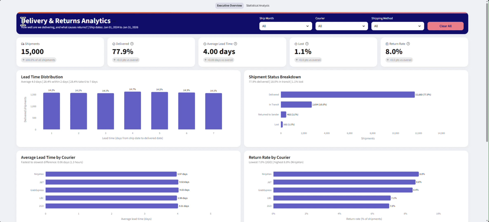
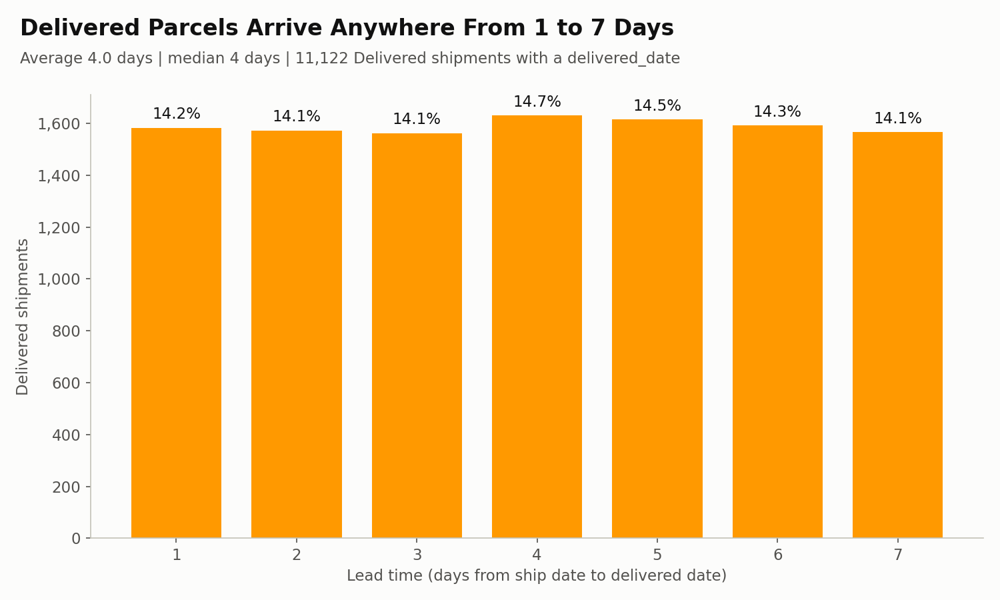
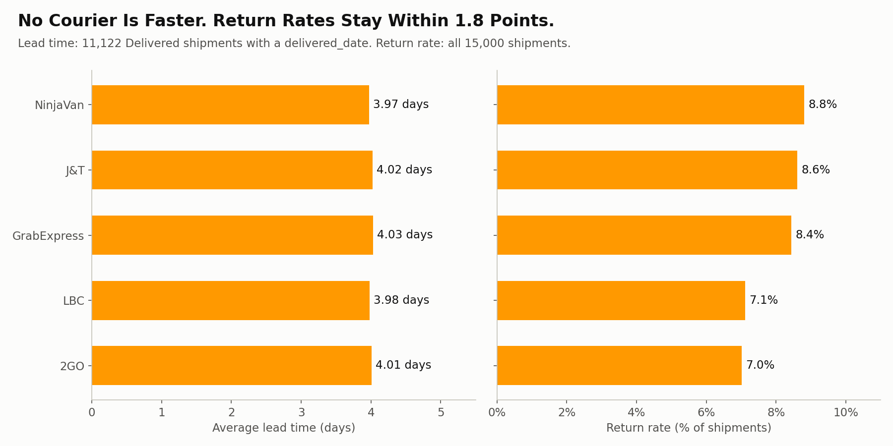
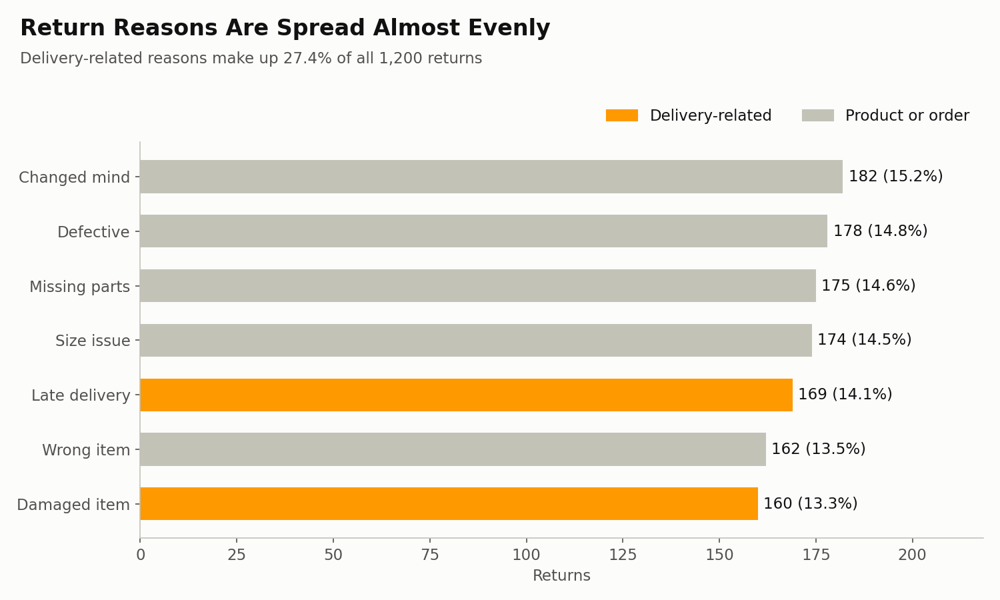
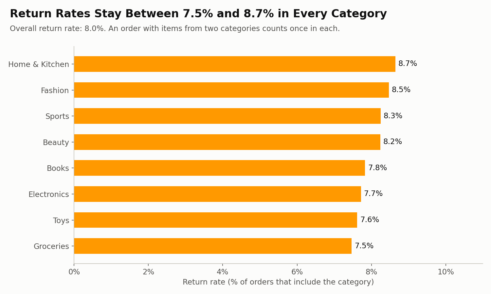
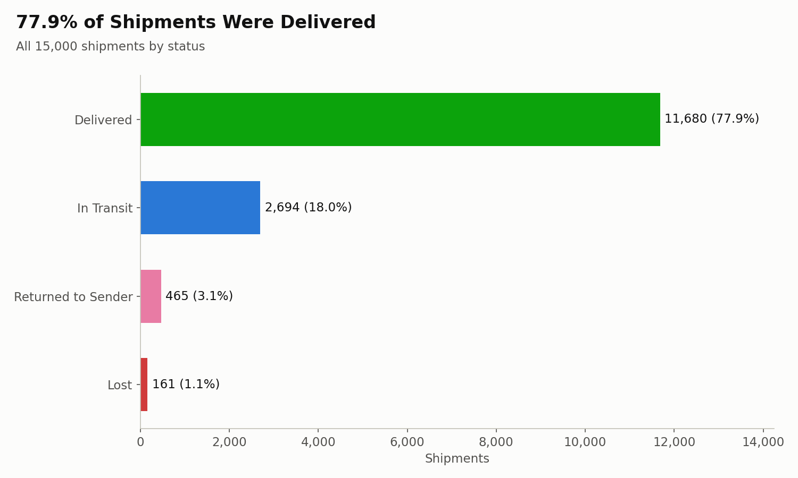
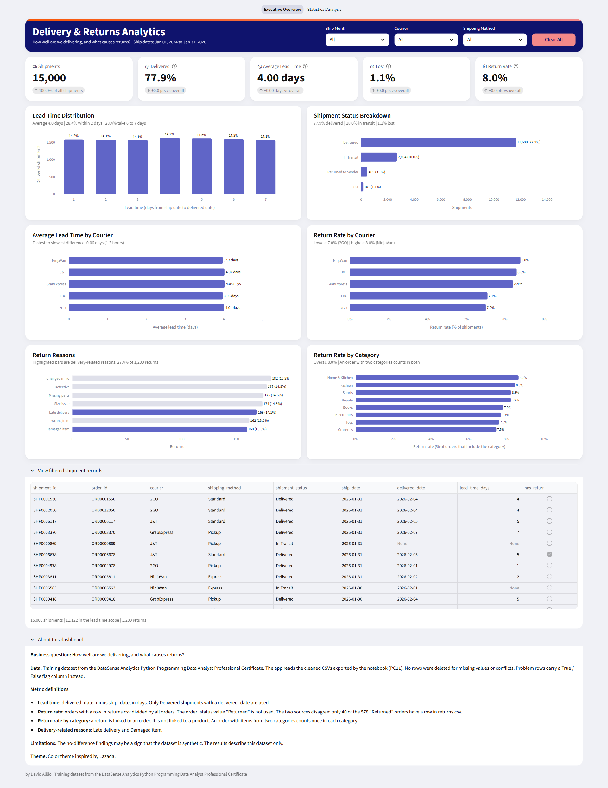
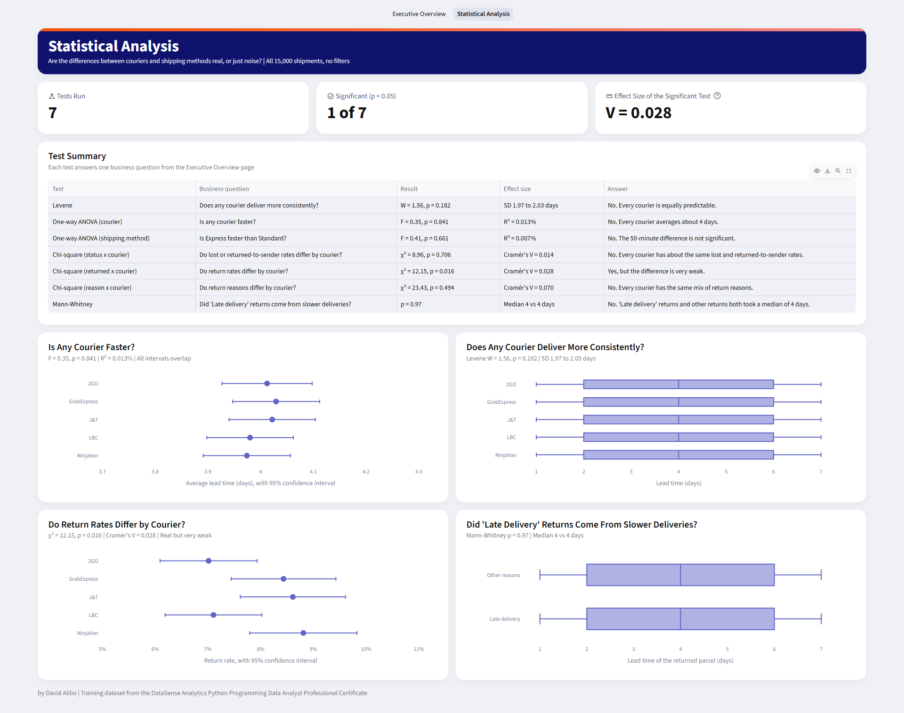

# Delivery & Returns Analytics (Python and Streamlit)

An end-to-end Python analytics project that answers one business question for a retail e-commerce store: **"How well are we delivering, and what causes returns?"** It covers data profiling and cleaning with a full cleaning log, a shipment-level fact table, delivery and returns metrics, five exported charts, seven statistical tests, and a two-page Streamlit dashboard.



**By:** David Alilio

**Live dashboard:** [Open the Streamlit app](https://delivery-and-returns-analytics.streamlit.app/)

## Table of Contents

- [Overview](#overview)
- [Executive Summary](#executive-summary)
- [Capstone Deliverables](#capstone-deliverables)
- [Dataset](#dataset)
- [Analytical Questions](#analytical-questions)
- [Data Preparation and Cleaning](#data-preparation-and-cleaning)
- [Analysis and Methodology](#analysis-and-methodology)
- [Visualizations](#visualizations)
- [Dashboard](#dashboard)
- [Key Findings and Insights](#key-findings-and-insights)
- [Recommendations](#recommendations)
- [Statistical Analysis](#statistical-analysis)
- [Key Metrics and Definitions](#key-metrics-and-definitions)
- [Limitations](#limitations)
- [Code Tag Index](#code-tag-index)
- [Error Log](#error-log)
- [How to Run](#how-to-run)
- [Repository Structure](#repository-structure)
- [Tools, Skills, and Optimization](#tools-skills-and-optimization)
- [Data Source and Credits](#data-source-and-credits)
- [Version History](#version-history)

## Overview

**Problem:** The store ships about 15,000 orders through five couriers and three shipping methods. It needs to know how fast and how reliably parcels arrive, whether any courier or shipping method performs better, and what drives customer returns.

**Approach:** I profiled all seven files before changing anything. Then I cleaned them in a fixed order and recorded every fix in a cleaning log. Rows with conflicts were flagged with True/False columns instead of deleted. This kept every original value as evidence. I built a shipment-level fact table, computed the delivery and returns metrics, exported five charts, and tested every courier and shipping method difference with a statistical test and an effect size. The results are shown in a two-page Streamlit dashboard.

Lead time was measured by its average and its spread. The spread shows how far delivery times vary from parcel to parcel. A delivery promise has to cover that spread.

**Scope:** Ship dates from January 1, 2024 to January 31, 2026. Lead time covers the 11,122 shipments with status Delivered and a delivered_date. The return rate uses returns.csv (1,200 returns across 15,000 orders).

## Executive Summary

- 15,000 shipments: 77.9% delivered, 18.0% in transit, 3.1% returned to sender, and 1.1% lost.
- Delivered parcels take 4.0 days on average (the median is also 4 days). Delivery times are spread evenly from 1 to 7 days after shipping: about 14% of parcels arrive in 1 day, about 14% in 2 days, and so on up to 7 days. No delivery time is more common than the others.
- About 28.4% of parcels arrive within 2 days, and another 28.4% take 6 to 7 days.
- No courier is faster (ANOVA p = 0.841). Averages range from 3.97 days (NinjaVan) to 4.03 days (GrabExpress). The difference is about 1.3 hours.
- Express is not faster than Standard: 3.98 days vs 4.01 days (ANOVA p = 0.661). Both methods charge about the same shipping fee.
- Every courier is equally predictable. The standard deviation per courier is 1.97 to 2.03 days (Levene p = 0.182).
- Every courier loses parcels and sends parcels back to the store at the same rate (p = 0.706, Cramér's V = 0.014).
- The return rate is 8.0% (1,200 of 15,000 orders).
- The courier return rate difference is real but very weak (p = 0.016, Cramér's V = 0.028). Rates range from 7.0% (2GO) to 8.8% (NinjaVan).
- Return reasons are spread almost evenly. Each reason holds 13.3% (Damaged item) to 15.2% (Changed mind) of returns.
- Delivery-related reasons make up 27.4% of returns. Product and order reasons make up 72.6%.
- "Late delivery" returns came from parcels that arrived in the same median 4 days as other returns (Mann-Whitney p = 0.97).
- Data quality: 387 exact duplicate rows were removed, and 15 flag columns mark rows with invalid values, broken keys, or business-rule conflicts.
- Top recommendations: match the Express promise to the actual 4-day delivery. Give delivery-related returns to Logistics and product or order returns to Merchandising and the warehouse. Record a promised delivery date for every order.

## Capstone Deliverables

| Deliverable | File |
|-|-|
| Executive summary | [`reports/executive_summary.txt`](reports/executive_summary.txt) |
| One-page insights summary | [`reports/one_page_insights_summary.pdf`](reports/one_page_insights_summary.pdf) |
| Project documentation | [`reports/E-Commerce_Delivery_and_Returns_Analytics_Project_Documentation.pdf`](reports/E-Commerce_Delivery_and_Returns_Analytics_Project_Documentation.pdf) |
| Notebook | [`notebooks/python_da_capstone_project_option_b.ipynb`](notebooks/python_da_capstone_project_option_b.ipynb) |
| Cleaned data and cleaning log | [`data/cleaned/`](data/cleaned/) (for example, `customers_clean.csv` and `products_clean.csv`) |
| Exported charts (PNG) | [`images/01_lead_time_distribution.png`](images/01_lead_time_distribution.png) to [`images/05_shipment_status_breakdown.png`](images/05_shipment_status_breakdown.png) |
| Dashboard | [`dashboard/app.py`](dashboard/app.py), the screenshots in [`images/`](images/), and the [live app](https://delivery-and-returns-analytics.streamlit.app/) |

## Dataset

A retail e-commerce training dataset with seven related CSV files. The data dictionary describes each column.

| File | Raw rows | Cleaned rows | Variables / Columns (raw) | Description |
|-|-|-|-|-|
| customers.csv | 5,050 | 5,000 | 13 | Customer profile, region, signup date, loyalty tier |
| products.csv | 800 | 800 | 9 | Product, brand, category, cost, price, stock |
| orders.csv | 15,075 | 15,000 | 8 | Order date, status, sales channel, shipping method, fee |
| order_items.csv | 37,763 | 37,501 | 5 | Products and quantities in each order |
| payments.csv | 15,000 | 15,000 | 6 | Payment method, status, date, amount |
| shipments.csv | 15,000 | 15,000 | 7 | Courier, tracking number, status, ship and delivered dates |
| returns.csv | 1,200 | 1,200 | 6 | Return request date, reason, refund flag and amount |
| **Total** | **89,888** | **89,501** | **54** | |

The cleaned files add flag columns. Their column counts are higher than the raw counts. The only rows removed were 387 exact duplicates.

## Analytical Questions

1. How fast do we deliver, and how consistent is the delivery time?
2. What percentage of shipments is delivered, in transit, returned to sender, or lost?
3. Does any courier or shipping method deliver faster, more consistently, or with fewer lost parcels?
4. What is the return rate, and which reasons, categories, and couriers drive returns?
5. Do "Late delivery" returns come from parcels that actually took longer to arrive?

## Data Preparation and Cleaning

Every fix was written to a cleaning log with the code tag, table, issue, action, rows before, rows after, reason, and how it was verified. The log has 42 rows and is exported as [`data/cleaned/cleaning_log.csv`](data/cleaned/cleaning_log.csv).

Two rules guided the cleaning:

- **Flag, do not delete.** Rows with invalid values or conflicts keep their original values and get a True/False flag column. Only exact duplicates were removed.
- **Missing does not mean zero.** Blanks were filled only when the right value was known. Other blanks stay blank. The `isna()` check already finds them.

<details>
<summary>Cleaning Summary Table (click to expand)</summary>

| Code Tag | Step | What was fixed | Result |
|-|-|-|-|
| PC1 | Profile every file | Shapes, data types, blanks, duplicates, and label variants checked before any change | Issue list for PC3 to PC9 |
| PC2 | Working copies and cleaning log | Raw files kept untouched; every fix is written to the log | 42 log rows |
| PC3 | Remove exact duplicates | Duplicate definition: every column identical | customers 50, orders 75, order_items 262 removed; 0 repeated IDs after |
| PC4 | Convert currency text | Money values stored as text with ₱ and commas | Converted to numbers |
| PC5 | Standardize labels | Category aliases and gender variants (M, F, female, and others) | 18 category labels to 8; gender to Male, Female, Unknown |
| PC6 | Parse mixed date formats | Dates in several formats | All parsed, 0 failures |
| PC7 | Handle missing values | Blank gender, loyalty_tier, refunded_flag, and unit_price_at_purchase | "Unknown" for labels; 2,227 prices backfilled from the product list price and flagged |
| PC8 | Flag invalid values and conflicts | Impossible values and fields that disagree within or across tables | 12 flag columns (see the next table) |
| PC9 | Check cross-file key integrity | IDs that do not exist in the parent table | 43 orders with CUST999999 and 129 order lines with PROD00000 flagged |
| PC10 | Validate the cleaned tables | Unique IDs, numeric money columns, date columns, label sets | All checks passed |
| PC11 | Export | Seven cleaned CSVs and the cleaning log | Shapes verified after reading the files back |

</details>

<details>
<summary>Data Conflicts Found (click to expand)</summary>

| Table | Flag | Rule | Rows flagged | % of table |
|-|-|-|-|-|
| customers | invalid_age | Age below 0 or above 100 | 48 | 1.0% |
| customers | invalid_email | Email not in name@domain.ext format | 225 | 4.5% |
| customers | invalid_phone | Phone number shorter than 10 digits | 133 | 2.7% |
| orders | orphan_customer | customer_id not found in customers (CUST999999) | 43 | 0.3% |
| order_items | price_was_backfilled | Blank unit_price_at_purchase filled with the product list price | 2,227 | 5.9% |
| order_items | invalid_order_line | Quantity of 0 or less | 372 | 1.0% |
| order_items | orphan_product | product_id not found in products (PROD00000) | 129 | 0.3% |
| shipments | undelivered_with_date | Status is not Delivered but a delivered_date exists | 3,149 | 21.0% |
| shipments | delivered_without_date | Status is Delivered but delivered_date is blank | 558 | 3.7% |
| shipments | shipped_before_order | ship_date is earlier than the order date | 7,397 | 49.3% |
| shipments | pickup_with_courier | Pickup order has a courier shipment | 4,924 | 32.8% |
| shipments | cancelled_but_delivered | Cancelled order has a delivered shipment | 938 | 6.3% |
| returns | refund_conflict | Yes or Partial with no refund amount, or No with a refund amount | 364 | 30.3% |
| returns | return_not_delivered | Return linked to a shipment that is not delivered | 260 | 21.7% |
| returns | return_before_delivery | Return requested before the delivered_date | 583 | 48.6% |

Two of these flags shape the analysis. First, 49.3% of ship dates are earlier than the order date. For this reason, lead time starts at the ship date. Second, Pickup orders have courier shipments in this dataset. Pickup lead time appears in the tables. No finding is based on it.

</details>

## Analysis and Methodology

**Fact table (PC12):** one row per shipment. Shipments were merged with orders using `validate="one_to_one"`. If a key repeats, the merge stops with an error. It never adds extra rows silently.

**Delivery metrics (PC13 and PC14):**

- Lead time = delivered_date minus ship_date (in days). It covers shipments with status Delivered and a delivered_date (11,122 rows).
- Status shares: delivered, in transit, returned to sender, and lost.
- For each courier and each shipping method: average lead time, standard deviation (spread), percentage delivered within 2 days, percentage taking 6 to 7 days, status percentages, and return rate.

**Returns metrics (PC15):**

- Return rate = orders with a row in returns.csv divided by all orders.
- Top return reasons in two groups: delivery-related (Late delivery, Damaged item) and product or order reasons.
- Return rate by category and by courier.

**Statistical tests (PC15, PC22 to PC24):** every difference between couriers or shipping methods was tested before it was called a finding. Each result is reported with an effect size. A statistically real difference can still be too small to act on.

- Levene's test checks whether the spread of lead time is equal. It also decides which ANOVA to use. Equal spreads allow a standard one-way ANOVA. Unequal spreads would need Welch's ANOVA.
- One-way ANOVA with R² compares average lead time. A Kruskal-Wallis test serves as a non-parametric check. Tukey's test runs only when the ANOVA is significant.
- Chi-square tests with Cramér's V compare status, return, and return reason percentages across couriers.
- A Mann-Whitney test compares the lead time of "Late delivery" returns with other returns.

## Visualizations

The notebook exports five charts as PNG files in `images/`.

| # | Chart | What it shows |
|-|-|-|
| 1 |  | Lead time is flat from 1 to 7 days. About 14% of parcels arrive in 1 day, about 14% in 2 days, and so on up to 7 days. |
| 2 |  | All five couriers average about 4 days. Return rates range from 7.0% to 8.8%. |
| 3 |  | The seven reasons are spread almost evenly. Delivery-related reasons are 27.4% of returns. |
| 4 |  | Category return rates range from 7.5% (Groceries) to 8.7% (Home & Kitchen). |
| 5 |  | 77.9% delivered, 18.0% in transit, 3.1% returned to sender, 1.1% lost. |

## Dashboard

A two-page Streamlit app (`dashboard/app.py`) built from the cleaned CSVs.

**Page 1: Executive Overview**

- Filters at the top right: Ship Month, Courier, Shipping Method, and a Clear All button.
- Five KPI cards: Shipments, Delivered, Average Lead Time, Lost, and Return Rate. Each card compares the filtered value with the overall value.
- Six charts: Lead Time Distribution, Shipment Status Breakdown, Average Lead Time by Courier, Return Rate by Courier, Return Reasons, and Return Rate by Category. Each chart has a one-line takeaway that updates with the filters.
- The courier charts keep all five couriers visible and highlight the selected courier. The selected courier is always shown next to its peers.
- An expandable table of the filtered shipment records and an About section with metric definitions.



**Page 2: Statistical Analysis**

- Three KPI cards: tests run, significant results, and the effect size of the significant test.
- A summary table that pairs each test with its business question and plain-language answer.
- Four charts: average lead time with 95% confidence intervals, lead time spread by courier, return rate with 95% confidence intervals, and the lead time of "Late delivery" returns vs other returns.
- This page uses all 15,000 shipments and ignores the filters. Every result matches the notebook.



**Color placeholder system:** every color is defined once in a `THEME` dictionary (SLT2). Every chart and style rule refers to a color by its name. This works like a base DAX measure that other measures reuse. A theme change edits only the placeholders. The Streamlit widget colors live in `.streamlit/config.toml` with the same values.

## Key Findings and Insights

Each finding uses both dashboard pages. The Executive Overview shows the numbers. The Statistical Analysis page tests whether a difference is real. Insights 8 and 9 come from the Executive Overview charts. Insight 10 comes from the data cleaning flags.

| # | Insight | Evidence | Why it matters |
|-|-|-|-|
| 1 | **Every courier is equally predictable**<details><summary>View details</summary>**Test result:** Lead time by courier: W = 1.56, p = 0.182. By shipping method: W = 0.17, p = 0.846. Standard deviation per courier: 1.97 to 2.03 days. Per shipping method: 1.99 to 2.00 days.<br><br>**Insight:** With each of the five couriers, about 28% of parcels arrive within 2 days and about 28% take 6 to 7 days. The same holds for Express, Standard, and Pickup. Switching couriers will not narrow the delivery window the store can promise.<br><br>**Importance:** A delivery promise depends on the average delivery time. It also depends on how far delivery times spread around that average. No courier and no shipping method offers a tighter spread today. Every delivered parcel arrived within 7 days of shipping.<br><br>**Recommendations:**<ul><li>**Short-Term:** Use the 1 to 7 day range as the delivery window in the one-category checkout pilot (Recommendation 3).</li><li>**Mid-Term:** Pilot a 3-day delivery target with one courier. Compare its spread with the other couriers over the same period.</li></ul>**Potential business impact:** Aligned the checkout delivery promise with what every courier already delivers.<br><br>**What it does not show:** Lead time starts at the ship date. It does not include the time between the order and the shipment.<br><br>**Where to see it:** Notebook PC14 and PC22. Executive Overview: Lead Time Distribution. Statistical Analysis: lead time spread by courier.</details> | SD 1.97 to 2.03 days; Levene W = 1.56, p = 0.182 | Switching couriers will not narrow the delivery window the store can promise. |
| 2 | **No courier is faster**<details><summary>View details</summary>**Test result:** F = 0.35, p = 0.841, R² = 0.013%. Average lead time: 3.97 days (NinjaVan) to 4.03 days (GrabExpress). Kruskal-Wallis check: p = 0.842. No Tukey test because the result is not statistically significant.<br><br>**Insight:** All five couriers deliver in about 4 days on average. The fastest and slowest couriers differ by about 1.3 hours (80 minutes). Courier explains only 0.013% of the differences in lead time.<br><br>**Importance:** Speed is not a reason to prefer one courier over another. Courier choice can rest on other factors such as cost and coverage. This dataset does not contain those factors.<br><br>**Recommendations:**<ul><li>**Short-Term:** Do not switch couriers or pay more for one courier based on speed claims alone.</li><li>**Mid-Term:** Collect cost per parcel and area coverage for each courier. Compare couriers on those factors next.</li></ul>**Potential business impact:** Avoided a courier switch for a speed gain of about 1.3 hours.<br><br>**What it does not show:** It covers delivered parcels only. Lost and In Transit parcels have no lead time.<br><br>**Where to see it:** Notebook PC14 and PC23. Executive Overview: Average Lead Time by Courier. Statistical Analysis: average lead time with 95% confidence intervals.</details> | 3.97 to 4.03 days; difference about 1.3 hours; F = 0.35, p = 0.841, R² = 0.013% | Speed is not a reason to prefer one courier. Cost and coverage are better reasons to choose one. |
| 3 | **Express is not faster than Standard**<details><summary>View details</summary>**Test result:** F = 0.41, p = 0.661, R² = 0.007%. Average lead time: Express 3.98 days, Standard 4.01 days, Pickup 4.02 days. Kruskal-Wallis check: p = 0.659. Levene: W = 0.17, p = 0.846.<br><br>**Insight:** Express parcels arrive in 3.98 days on average. Standard parcels take 4.01 days. The difference is about 50 minutes. The average shipping fee is also about the same (Express ₱85.51, Standard ₱85.92).<br><br>**Importance:** A customer who picks Express expects a faster parcel. In this data, that customer gets the same 4-day delivery as Standard. This mismatch is a likely trust risk.<br><br>**Recommendations:**<ul><li>**Short-Term:** Review what the Express option promises at checkout. Match the wording to the actual 4-day average.</li><li>**Mid-Term:** Pilot a true Express service with one courier. Compare its lead time with Standard over the same period.</li></ul>**Potential business impact:** Protected customer trust by matching the Express label to actual delivery times.<br><br>**What it does not show:** The dataset cannot show whether Express orders ship sooner after the order. 49.3% of shipments have a ship_date earlier than the order date. That step cannot be measured reliably. Pickup orders also have courier shipments in this dataset (flag `pickup_with_courier`). Pickup orders should not need a courier. Pickup lead time appears in the tables. No finding is based on it.<br><br>**Where to see it:** Notebook PC13 and PC23. Executive Overview: the Shipping Method filter with the Average Lead Time card. Statistical Analysis: test summary table.</details> | 3.98 vs 4.01 days; F = 0.41, p = 0.661; fee ₱85.51 vs ₱85.92 | Customers who pick Express expect a faster parcel. A promise that is not kept is a likely trust risk. |
| 4 | **Lost and returned-to-sender rates are the same across couriers**<details><summary>View details</summary>**Test result:** χ² = 8.96, df = 12, p = 0.706, Cramér's V = 0.014.<br><br>**Insight:** Overall, 77.9% of shipments were delivered, 18.0% were in transit, 3.1% were returned to sender, and 1.1% were lost. Each courier stays close to these percentages. Lost parcels range from 0.8% (NinjaVan) to 1.2% (GrabExpress and J&T).<br><br>**Importance:** No courier loses or returns more parcels than the others. Lost and returned-to-sender parcels are a shared problem across all couriers.<br><br>**Recommendations:**<ul><li>**Short-Term:** Review a sample of returned-to-sender parcels to find their common cause. Check for wrong addresses first.</li><li>**Mid-Term:** Track lost and returned-to-sender rates per courier every month. Act only on a courier that moves away from the shared rate.</li></ul>**Potential business impact:** Focused loss-reduction work on the shared process instead of a courier switch.<br><br>**What it does not show:** Why parcels were lost or returned to sender. The dataset has no reason field for these statuses.<br><br>**Where to see it:** Notebook PC14 and PC24. Executive Overview: Shipment Status Breakdown. Statistical Analysis: test summary table.</details> | χ² = 8.96, p = 0.706, V = 0.014; lost 0.8% to 1.2% | Losses are a shared process problem. They are not tied to one courier. |
| 5 | **The courier return rate difference is real but small**<details><summary>View details</summary>**Test result:** χ² = 12.15, df = 4, p = 0.016, Cramér's V = 0.028.<br><br>**Insight:** The percentage of shipments with a return ranges from 7.0% (2GO, 207 of 2,951) to 8.8% (NinjaVan, 263 of 2,985). The difference is real (p = 0.016) but very weak (Cramér's V = 0.028).<br><br>**Importance:** A 1.8 percentage point difference is too small to justify a courier switch on returns alone. Return reasons also look the same for every courier (Insight 6). The data does not point to a courier-specific problem.<br><br>**Recommendations:**<ul><li>**Short-Term:** Keep the current couriers. Do not switch based on this return rate difference.</li><li>**Mid-Term:** Rerun this test every quarter. Investigate a courier only if its return rate pulls further away from the others.</li></ul>**Potential business impact:** Avoided a courier switch based on a 1.8 percentage point difference.<br><br>**What it does not show:** Whether the courier is the reason for a return. The returns data has no field that links a return to courier handling.<br><br>**Where to see it:** Notebook PC14 and PC24. Executive Overview: Return Rate by Courier. Statistical Analysis: return rate with 95% confidence intervals.</details> | 7.0% (2GO) to 8.8% (NinjaVan); χ² = 12.15, p = 0.016, V = 0.028 | A 1.8 percentage point difference is too small to justify a courier switch. |
| 6 | **Return reasons look the same for every courier**<details><summary>View details</summary>**Test result:** χ² = 23.43, df = 24, p = 0.494, Cramér's V = 0.070. Smallest expected count: 27.6.<br><br>**Insight:** The seven return reasons are spread almost evenly. They range from 13.3% (Damaged item) to 15.2% (Changed mind). The mix of reasons does not differ by courier.<br><br>**Importance:** Delivery-related reasons (Damaged item and Late delivery) make up 27.4% of returns. No courier has a bigger share of them. The other 72.6% point to the product, the order, or the customer's choice. Reducing returns needs work on products and order accuracy as much as on delivery.<br><br>**Recommendations:**<ul><li>**Short-Term:** Report return reasons in two groups every month: delivery-related (27.4%) and product or order (72.6%).</li><li>**Mid-Term:** Give each group to the team that can fix it. Logistics owns delivery-related reasons. Merchandising and the warehouse own product and order reasons.</li></ul>**Potential business impact:** Prioritized the product and order reasons behind 72.6% of returns.<br><br>**What it does not show:** The deeper cause behind each return reason. For example, "Changed mind" has no follow-up detail.<br><br>**Where to see it:** Notebook PC19 and PC24. Executive Overview: Return Reasons (highlighted bars are delivery-related).</details> | 13.3% to 15.2% per reason; χ² = 23.43, p = 0.494, V = 0.070 | 72.6% of returns point to the product or the order. Only 27.4% point to the delivery. |
| 7 | **"Late delivery" returns did not come from slower deliveries**<details><summary>View details</summary>**Test result:** Median lead time 4 days for "Late delivery" returns (n = 135) and 4 days for other reasons (n = 759). Mann-Whitney p = 0.97. Only returns linked to delivered parcels are included.<br><br>**Insight:** 169 of 1,200 returns (14.1%) cite "Late delivery." Their parcels arrived in a median of 4 days. Parcels returned for other reasons also arrived in a median of 4 days.<br><br>**Importance:** "Late" likely means later than the customer expected. The dataset has no promised delivery date to confirm this.<br><br>**Recommendations:**<ul><li>**Short-Term:** Pilot a clear delivery window at checkout for one category.</li><li>**Mid-Term:** Record the promised delivery date for every order.</li></ul>**Potential business impact:** Enabled a one-category test of whether clearer delivery windows lower "Late delivery" returns.<br><br>**What it does not show:** What delivery time the customer expected. There is no promised-date field.<br><br>**Where to see it:** Notebook PC15 (Part D) and PC19. Executive Overview: Return Reasons. Statistical Analysis: lead time of "Late delivery" returns vs other returns.</details> | Median 4 vs 4 days; Mann-Whitney p = 0.97 | "Late" likely means later than the customer expected. |
| 8 | **Every category has about the same return rate**<details><summary>View details</summary>**Test result:** No statistical test. Return rate by category: Home & Kitchen 8.7%, Fashion 8.5%, Sports 8.3%, Beauty 8.2%, Books 7.8%, Electronics 7.7%, Toys 7.6%, and Groceries 7.5%.<br><br>**Insight:** The highest and lowest categories differ by only 1.2 percentage points. Every category sits close to the overall 8.0% return rate.<br><br>**Importance:** Returns are not concentrated in one category. A fix for a single category will not lower the overall return rate by much. The return reasons are a better place to start (Insight 6).<br><br>**Recommendations:**<ul><li>**Short-Term:** Keep the category return rate in the monthly returns report. Watch for a category that moves away from the others.</li><li>**Mid-Term:** Break down the return reasons by category. A pair such as "Size issue" in Fashion may show a problem that a single category rate hides.</li></ul>**Potential business impact:** Avoided a category-specific fix that would not move the overall return rate.<br><br>**What it does not show:** Which product inside a category drives returns. A return is linked to an order. It is not linked to a product. An order with items from two categories counts in both.<br><br>**Where to see it:** Notebook PC15 (Part C) and PC20. Executive Overview: Return Rate by Category.</details> | 7.5% (Groceries) to 8.7% (Home & Kitchen) | Returns are not concentrated in one category. Fixing a single category will not lower the 8.0% return rate by much. |
| 9 | **Delivery time is spread evenly from 1 to 7 days**<details><summary>View details</summary>**Test result:** No statistical test. Lead time from 1 to 7 days: 14.1% to 14.7% of delivered parcels per day. Average 4.0 days, median 4 days. 28.38% (3,156 parcels) arrive within 2 days. 28.39% (3,158 parcels) take 6 to 7 days. 42.9% take more than 4 days.<br><br>**Insight:** Lead time counts the days from shipping to delivery. It is not a day of the week. About as many parcels arrive in 1 day as in 7 days. No delivery time is more common than the others. We cannot say that more parcels arrive in 4 days than in 2 days.<br><br>**Importance:** The 4-day average hides a wide spread. A 4-day promise would be late for 42.9% of delivered parcels. Every delivered parcel arrived within 7 days of shipping.<br><br>**Recommendations:**<ul><li>**Short-Term:** Show a delivery window of 1 to 7 days at checkout instead of a single date.</li><li>**Mid-Term:** Work with the couriers to shorten the 6 to 7 day tail. Track the percentage of parcels that take 6 to 7 days every month.</li></ul>**Potential business impact:** Set a delivery promise that every delivered parcel in this data met.<br><br>**What it does not show:** Why some parcels take 6 to 7 days. The dataset has no route or distance field.<br><br>**Where to see it:** Notebook PC13 and PC17. Executive Overview: Lead Time Distribution and the Average Lead Time card.</details> | Each day from 1 to 7 holds 14.1% to 14.7% of delivered parcels; 28.4% arrive within 2 days and 28.4% take 6 to 7 days | A promise based on the 4-day average will be late for at least the 28.4% of parcels that take 6 to 7 days. |
| 10 | **Shipment dates are not reliable**<details><summary>View details</summary>**Test result:** No statistical test. PC8 flags: shipped_before_order 7,397 (49.3%), undelivered_with_date 3,149 (21.0%), cancelled_but_delivered 938 (6.3%), and delivered_without_date 558 (3.7%).<br><br>**Insight:** Almost half of the ship dates are earlier than their order dates. A parcel cannot ship before the order exists. Status and date fields also disagree in thousands of rows.<br><br>**Importance:** Order-to-delivered time is the wait the customer actually feels. It cannot be measured until the dates are reliable. The 4.0-day lead time covers only the part from shipping to delivery.<br><br>**Recommendations:**<ul><li>**Short-Term:** Keep the flags in every report. Report the percentage of shipments with valid dates every month.</li><li>**Mid-Term:** Record ship and delivered dates from courier scans (Recommendation 5).</li></ul>**Potential business impact:** Enabled order-to-delivered tracking once the dates are fixed.<br><br>**What it does not show:** The root cause. The data cannot tell whether the dates were typed wrong, came from a time zone or date format mismatch, or were generated at random.<br><br>**Where to see it:** Notebook PC8 output, the Data Conflicts table above, and `data/cleaned/cleaning_log.csv`.</details> | 49.3% shipped before the order date; 21.0% undelivered but with a delivered date; 6.3% cancelled but delivered | The rows were flagged and kept. Lead time was measured from the ship date to delivered date only and not from order date to delivered date. Order-to-delivered time needs correct dates at the source (Recommendation 5). |

## Recommendations

1. **Match the Express promise to actual delivery.** Review what the Express option promises at checkout and match it to the 4-day average. Then pilot a true Express service with one courier and compare it with Standard over the same period.
2. **Split returns by the team that can fix them.** Delivery-related returns (27.4%: Late delivery and Damaged item) go to Logistics. Product or order returns (72.6%: Defective, Wrong item, Missing parts, Size issue, and Changed mind) go to Merchandising and the warehouse. Each team tracks its group every month.
3. **Record a promised delivery date for every order.** This makes "Late delivery" measurable. Test it first in one category. Show a clear delivery window at checkout (for example, "Arrives in 1 to 7 days"). Then compare its "Late delivery" returns with other categories.
4. **Keep the current couriers and compare them on cost and coverage next.** Speed, spread, losses, and returns show no difference large enough to justify switching couriers.
5. **Record shipment dates from system scans.** Take the ship date from the courier pickup scan and the delivered date from the proof-of-delivery scan. Add a daily data quality check that flags any ship date earlier than its order date. Logistics owns the fix and tracks the percentage of shipments with valid dates.

## Statistical Analysis

| Test | Business question | Result | Effect size | Answer |
|-|-|-|-|-|
| Levene | Does any courier deliver more consistently? | W = 1.56, p = 0.182 | SD 1.97 to 2.03 days | No. Every courier is equally predictable. |
| One-way ANOVA (courier) | Is any courier faster? | F = 0.35, p = 0.841 | R² = 0.013% | No. Every courier averages about 4 days. |
| One-way ANOVA (shipping method) | Is Express faster than Standard? | F = 0.41, p = 0.661 | R² = 0.007% | No. The 50-minute difference is not significant. |
| Chi-square (status x courier) | Do lost or returned-to-sender rates differ by courier? | χ² = 8.96, p = 0.706 | Cramér's V = 0.014 | No. Every courier has about the same lost and returned-to-sender rates. |
| Chi-square (returned x courier) | Do return rates differ by courier? | χ² = 12.15, p = 0.016 | Cramér's V = 0.028 | Yes, but the difference is very weak. |
| Chi-square (reason x courier) | Do return reasons differ by courier? | χ² = 23.43, p = 0.494 | Cramér's V = 0.070 | No. Every courier has the same mix of return reasons. |
| Mann-Whitney | Did "Late delivery" returns come from slower deliveries? | p = 0.97 | Median 4 vs 4 days | No. "Late delivery" returns and other returns both took a median of 4 days. |

Kruskal-Wallis is a backup test that does not need bell-shaped data. It agrees with both ANOVAs (p = 0.842 for courier, p = 0.659 for shipping method). The smallest expected count in the chi-square tests is 27.6. A common rule of thumb asks for more than 5 per cell.

## Key Metrics and Definitions

<details>
<summary>Metric definitions (click to expand)</summary>

| Metric | Definition | Value |
|-|-|-|
| Shipments | Rows in shipments.csv after cleaning | 15,000 |
| Delivered % | Shipments with status Delivered divided by all shipments | 77.9% |
| Lead time | delivered_date minus ship_date (in days). Delivered shipments with a delivered_date only. | 4.0 days average |
| Within 2 days | Percentage of delivered parcels with a lead time of 2 days or less | 28.38% (3,156 parcels) |
| 6 to 7 days | Percentage of delivered parcels with a lead time of 6 or 7 days | 28.39% (3,158 parcels) |
| Lost % | Shipments with status Lost divided by all shipments | 1.1% |
| Return rate | Returns in returns.csv (1,200) divided by all orders (15,000). The order_status column also has a "Returned" value. It was not used. The two sources disagree: only 40 of the 578 "Returned" orders have a row in returns.csv. | 8.0% |
| Return rate by category | Orders that include the category and have a return divided by all orders that include the category. An order with items from two categories counts in both. | 7.5% to 8.7% |
| Delivery-related returns | Returns with reason Late delivery or Damaged item | 27.4% |
| p-value | The probability of a difference at least this large if there were no real difference. Below 0.05 counts as significant. | p < 0.05 |
| R² | The percentage of lead time differences explained by the group (courier or shipping method) | 0.013% and 0.007% |
| Cramér's V | A 0-to-1 scale of how strong a chi-square relationship is | 0.014 to 0.070 |

</details>

## Limitations

- The no-difference findings may be a sign that the dataset is synthetic. The results describe this dataset only.
- Lead time starts at the ship date. The time from order to shipment cannot be measured reliably. In 49.3% of shipments, the ship date is earlier than the order date.
- The dataset has no promised or standard delivery date, no reason field for lost or returned-to-sender parcels, and no courier cost or coverage data.

## Code Tag Index

Every code block has a tag. Notebook cells use PC (Python Code) tags, and the dashboard uses SLT (Streamlit) tags.

<details>
<summary>PC1 to PC24: Notebook (click to expand)</summary>

| Tag | Name / Description |
|-|-|
| PC1 | Profile Every File Before You Clean It |
| PC2 | Create Working Copies and the Cleaning Log |
| PC3 | Remove Exact Duplicates |
| PC4 | Convert Currency Text to Numbers |
| PC5 | Standardize Category and Gender Labels |
| PC6 | Parse Mixed Date Formats |
| PC7 | Handle Missing Values |
| PC8 | Flag Invalid Values and Business-Rule Conflicts |
| PC9 | Check Cross-File Key Integrity |
| PC10 | Validate the Cleaned Tables |
| PC11 | Export Cleaned CSVs and the Cleaning Log |
| PC12 | Shipment-Level Fact Table |
| PC13 | Delivery Metrics |
| PC14 | Courier Comparison |
| PC15 | Returns Metrics |
| PC16 | Color Theme Placeholders |
| PC17 | Lead Time Distribution |
| PC18 | Courier Comparison Chart |
| PC19 | Return Reasons |
| PC20 | Return Rate by Category |
| PC21 | Shipment Status Breakdown |
| PC22 | Levene's Test for Equal Variances |
| PC23 | One-way ANOVA (Tukey only if significant) |
| PC24 | Chi-Square and Cramér's V |

</details>

<details>
<summary>SLT1 to SLT15: Dashboard (click to expand)</summary>

| Tag | Name / Description |
|-|-|
| SLT1 | Imports and Page Setup |
| SLT2 | Theme Placeholders (THEME dictionary, card styling, and `style_chart()`) |
| SLT3 | Cached Data Load (rebuilds the PC12 fact table and the PC15 order categories) |
| SLT4 | Header and Filters |
| SLT5 | Apply Filters and Empty Check |
| SLT6 | KPI Cards |
| SLT7 | Lead Time Distribution |
| SLT8 | Shipment Status Breakdown |
| SLT9 | Courier Comparison |
| SLT10 | Returns Charts |
| SLT11 | Detail Table |
| SLT12 | About This Dashboard |
| SLT13 | Statistical Tests (cached) |
| SLT14 | Statistical Analysis Page |
| SLT15 | Page Navigation |

</details>

## Error Log

Errors I hit while building this project and how I fixed them.

<details>
<summary>Error Log (click to expand)</summary>

| Tag | Where | Problem | Fix |
|-|-|-|-|
| E1 | PC8 | The email pattern used `[A-Z-z]` instead of `[A-Za-z]`. It flagged 4,896 emails as invalid instead of 225. | Corrected the character range and reran the notebook. |
| E2 | PC10 | The shape printout used `str(df.shape)<13` instead of the format spec `:<13`, and the duplicate count used `duplicated.sum()` without the parentheses. | Changed to `{str(df.shape):<13}` and `duplicated().sum()`. |
| E3 | PC15 | A misplaced bracket in `it[~it["invalid_order_line"]] & ~it["orphan_product"]` tried to build a 10.4 GiB array. It raised a MemoryError and crashed the kernel. | Moved the bracket so both conditions sit inside one filter. |
| E4 | PC15 | `drop_duplicates()` ran before keeping only the order and category columns. Home & Kitchen counted 4,522 orders instead of 4,034. | Selected `[["order_id", "category"]]` first and then dropped duplicates. |
| E5 | PC19 | The format spec `.1f%` is not valid for percentages. | Changed it to `.1%`. |
| E6 | dashboard | `app.py` was first created as a notebook and then renamed. The file held notebook JSON instead of Python code. | Deleted it and created a plain text file named `app.py`. |
| E7 | SLT8 | NameError: `STATUS_COLORS` was deleted from SLT2 while the status chart still used it. | Changed the chart to one color, `color_discrete_sequence=[THEME["accent"]]`. |
| E8 | SLT2 | The header CSS was typed above `<style>`. It showed as plain text on the page. | Moved the lines inside the `<style>` block. |
| E9 | SLT2 | The header stripe CSS used commas instead of semicolons (`content: "",`). The browser ignored those lines, and the stripe did not show. | Replaced the commas with semicolons. |
| E10 | SLT13 | UnhashableParamError: `@st.cache_data` could not hash the `fact` DataFrame passed to `run_tests()`. | Renamed the arguments to `_fact` and `_returns`. A leading underscore tells Streamlit to skip hashing an argument. |
| E11 | SLT15 | NameError: `position-"top"` used a minus sign. Python read `position` as a variable. | Changed it to `position="top"`. |
| E12 | SLT15 | The page links stayed on the left. My Streamlit version has no `stTopNav` test ID. The centering CSS matched nothing. | Inspected the nav bar in the browser DevTools, found the `.rc-overflow` container, and centered that instead. |
| E13 | SLT10 | In the tall screenshots, the Return Reasons legend covered the "182 (15.2%)" label of the top bar. | Removed the legend and moved the color meaning into the chart subtitle ("Highlighted bars are delivery-related reasons"). |

</details>

## How to Run

You need Anaconda installed. It includes Python, Jupyter Notebook, and Anaconda Prompt.

1. Download this repository. On GitHub, click **Code > Download ZIP**. Extract the ZIP file to a folder on your computer. This folder is the repository root.
2. Open **Anaconda Prompt** on Windows or **Terminal** on macOS.
3. Go to the repository root. Replace the path with your own folder:
   ```
   cd /d "C:\Users\YourName\Downloads\your-repo-folder"
   ```
   On macOS, leave out `/d`.
4. Install the packages:
   ```
   pip install -r requirements.txt
   ```
5. Optional: run the notebook. The cleaned CSVs and the charts are already in this repository. Skip to step 6 if you only want to see the dashboard.
   1. Type `jupyter notebook` and press Enter. Jupyter opens in your browser.
   2. Open `notebooks/python_da_capstone_project_option_b.ipynb`.
   3. Click **Kernel > Restart Kernel and Run All Cells**. The notebook writes the cleaned CSVs and the cleaning log to `data/cleaned/` and the charts to `images/`.
6. Start the dashboard. If Jupyter is still running, open a new Anaconda Prompt and repeat step 3 first. Then type this:
   ```
   streamlit run dashboard/app.py
   ```
7. The dashboard opens in your browser at `http://localhost:8501`. To stop it, press **Ctrl+C** in Anaconda Prompt.

Always start the dashboard from the repository root. Streamlit reads the theme in `.streamlit/config.toml` from the folder where you run `streamlit run`.

## Repository Structure

```
.
├── .streamlit/
│   └── config.toml                  Streamlit theme
├── dashboard/
│   └── app.py                       Streamlit dashboard (SLT1 to SLT15)
├── data/
│   ├── raw/                         7 original CSV files
│   └── cleaned/                     7 cleaned CSV files and cleaning_log.csv
├── images/                          Dashboard screenshots, the walkthrough GIF, and the 5 exported charts
├── notebooks/
│   └── python_da_capstone_project_option_b.ipynb
├── reports/                         Executive summary, one-page insights summary, and project documentation
├── .gitignore
├── requirements.txt
└── README.md
```

## Tools, Skills, and Optimization

- **Python (pandas):** profiling, cleaning, flag columns, key-integrity checks, merges, and aggregations
- **matplotlib and seaborn:** the five exported charts
- **SciPy:** Levene, one-way ANOVA, Kruskal-Wallis, chi-square, and Mann-Whitney tests
- **Plotly and Streamlit:** the interactive two-page dashboard
- **Jupyter Notebook (Anaconda):** analysis notebook
- **Git and GitHub:** version control
- **Business analysis and data storytelling:** insights, recommendations, and potential business impact

Optimization practices applied:

1. `@st.cache_data` loads the CSVs and runs the statistical tests once. A filter change reuses the cached results.
2. One `THEME` dictionary holds every color. A theme change edits only the placeholders.
3. `merge(validate="one_to_one")` stops the merge if a key repeats. It never adds rows silently.
4. Flag columns keep every row and its original values. Every count in this README can be traced back to the data.
5. A cleaning log records every fix with the rows before, rows after, and how it was verified.
6. Each code block has a PC or SLT tag. A number in the README or dashboard can be traced to the code that produced it.

## Data Source and Credits

- **Data:** a retail e-commerce training dataset from the DataSense Analytics Python Programming Data Analyst Professional Certificate.
- **Color theme:** inspired by Lazada.

## Version History

- **v1 (November 2026):** Submitted as the capstone project for the Python Programming Data Analyst Professional Certificate by DataSense Analytics.
- **v1.1 (November 2026):** Added the live dashboard, the walkthrough GIF, the one-page insights summary, and the project documentation. Fixed the Sports label in the category chart and aligned the dashboard text with this README.